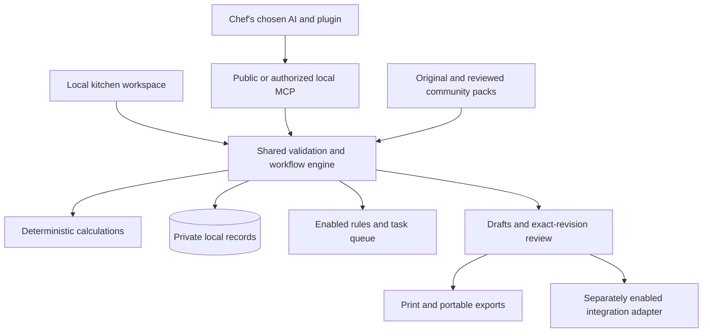

# Open Kitchen Toolkit: expansion roadmap

Planning date: 2026-10-26. Status: proposed implementation sequence. Version labels describe intended scope, not delivery dates. Application code remains unchanged in this planning pass.

Implementation update, 0.2.1: the first guided-workspace increment is implemented and locally verified (setup checklist/public service diagnostic, common job entry, resumable event forms, AI handoff and printable documents). See ACCEPTANCE_021.md. Native AI-host acceptance and the 387 host conversations remain incomplete; M1 is not fully closed. M2–M6 remain roadmap work.

## Product direction

Build a free, open-source kitchen operating companion that works through the chef's preferred AI and a practical local workspace. A chef should be able to bring restaurant records, complete a useful job, review the evidence, approve a draft and return later to find the work intact.

The product has three cooperating parts:

1. AI plugin: finds relevant workflows, asks for missing information and prepares narrative drafts through the chosen AI host.
2. Kitchen workspace: holds private records, guided forms, files, tasks, approvals, printouts and enabled schedules.
3. Shared engine: performs deterministic calculations, validates records, tracks dependencies and runs explicit rules.

Expand through compatible workflow packs. One canonical workflow may appear in several packs; do not duplicate its implementation or inflate the skill count. Maintain original content and independent branding. Axomai remains a bounded comparison target, never a source of redistributed proprietary instructions.

Software and skills remain free and MIT licensed. No toolkit account or mandatory model API key. Provider accounts/fees still apply. CulinaryOS remains optional. Hosted team services, unattended hosting and commercial integrations require separate scope and operating-cost decisions.

## Current baseline and constraints

Current repository documents record 73 original workflows, 14 public tools, five connected flows and 105 passing automated tests for release 0.2.0. This planning pass inspected source documentation and clean Git status; it did not rerun those tests or repeat deployment acceptance.

Existing capabilities include a local SQLite workspace, reviewed imports, recipe costing, tasks, source-versioned documents/approvals, an embedded rules worker and client adapters. Browser acceptance covered synthetic phone/desktop interactions.

Important unfinished acceptance:

- Native AI-client installation and calculation calls remain incomplete. Prior Codex calls were blocked by host approval policy; Gemini CLI connected but its model session did not expose the tools. Reproduce with current clients and respect host permissions.
- The 387 host scenarios are designed cases, not completed conversations. The 146 stored examples received editorial review, which is a different check.
- Event planning and service-close inputs currently require structured local MCP requests; the UI can inspect their results and approvals.
- PDF/image interpretation stays in the chosen AI host. Structured JSON/CSV and pasted-text handling exist; a reviewed extraction pipeline is still needed.
- Closing the local workspace stops scheduled processing. No background narrative generation or live CulinaryOS API synchronization exists.

## Chef experience

The main entry asks **What do you need to get done?** Show common jobs such as cost a dish, prepare tomorrow, compare a delivery, plan an event and close a service. Keep library search available for less frequent jobs.

Every job follows the same understandable sequence:

Choose job → select records/files → resolve missing inputs → calculate → prepare draft → review/approve → print/export → follow-up tasks.

The chef can save unfinished work and resume it. Display the missing field, affected result and next useful action. Separate estimates from confirmed records and operational approvals from simple task completion.

Offer an “Ask in my AI” handoff containing only the chef-selected records and the requested output format, with a data preview before copying or sending. Where a host supports live tools, it can retrieve the authorized records directly. A local chat-shaped screen must not imply a working model connection; embedded chat is a later optional adapter using verified host interfaces.

## Delivery sequence

| Milestone | Chef outcome | Included work | Release gate |
|---|---|---|---|
| M1 / 0.2.x: dependable foundation | Connect an AI and complete the first kitchen job | Client diagnostics, first-run setup, guided examples, task/blocker clarity, acceptance runner | Actual discovery, workflow retrieval and known-cost call in each claimed client; unsupported/unavailable rows remain explicit |
| M2 / 0.3: daily kitchen desk | Manage all five connected jobs from the UI | Guided job launcher, complete event/close forms, record editors, inbox, document preview/printing, resume/cancel | Each connected flow finishes through the UI; missing/stale inputs block; phone and desktop checks |
| M3 / 0.4: bring your kitchen data | Import a supplier file or menu and reconcile it | Reviewed file attachments/extraction, mapping, duplicate detection, ingredient aliases, yield/pack records, reconciliation queue | A source file traces through confirmed records to costs and SOP drafts without invented fields or source modification |
| M4 / 0.5: planning and control | Turn demand and stock into an achievable service plan | Forecast scenarios, ingredient demand, purchasing, receiving, counts, actual yield, equipment/labor intervals, price-impact review | Independently keyed numerical tests; counts, packs, waste, prices and approvals reconcile through a complete service cycle |
| M5 / 0.6: specialist packs | Handle different restaurant businesses using shared tools | Food truck/catering, bakery/batch, multi-site reporting, training, verified dietary/traceability records | Each pack has complete jobs, original examples, compatible metadata and at least one measured pilot |
| M6 / 1.0 candidate: community platform | Install reviewed community packs and optional connectors | Pack registry/validation, contribution process, export compatibility, connector contracts and pilot evidence | Recovery, supported clients, migration, privacy and operational acceptance meet published criteria |

Release M1 and M2 before starting broad specialist expansion. M3 and M4 build the data foundation used by later packs. Multi-user hosting and live external writes are later architecture decisions, not hidden dependencies of these milestones.

## Requirements and technical ownership

Continue the current F01–F23 requirement identifiers; reserve these additions:

| ID | Requirement | Owning area / contract |
|---|---|---|
| F24 | First-run kitchen setup and client diagnostics | UI + client adapters; detect prerequisites, show public/private modes, merge configuration safely |
| F25 | Guided jobs and resumable task inbox | UI + existing connected-flow engine; owner, due time, blocker reason, next action, explicit local timezone |
| F26 | Complete event and close forms | Existing budget/capacity/stock schemas; validation shared with MCP, no separate calculation formulas in UI |
| F27 | Source attachments and reviewed extraction | Local data/import modules; immutable file hashes, selected storage directory, review preview and source-linked fields |
| F28 | Ingredient/supplier/pack reconciliation | Data records + deterministic tools; aliases, compatible units, measured yield, effective-date prices and explicit unresolved matches |
| F29 | Inventory and purchasing cycle | Transactions, stock counts, receiving, waste and ordering proposals; preserve existing public calculator contracts |
| F30 | Scenario planning | Versioned scenario inputs and calculations; no changes to operational stock or prices until an explicitly approved action |
| F31 | Capacity and production planning | Existing interval validation plus explicit labor/equipment constraints; report infeasibility before generating a production draft |
| F32 | Workflow packs and reusable job templates | Catalog/discovery; stable IDs, pack compatibility, declared permissions and complete examples |
| F33 | Optional integration adapters | Separate modules with import/export/action contracts, explicit tenant/site binding and isolated tests |
| F34 | Evaluation, recovery and benefit measurement | Scenario harness, client evidence, backup/restore tests and opt-in local pilot reports |

Reuse the existing TypeScript, SQLite, MCP and React/Vite stack. Preserve published tool names and workflow IDs. Introduce new tools only for distinct operations; keep common record validation and calculations in shared modules. Paginate and search growing datasets rather than sending entire kitchens into model context.

## Architecture and application flows

Public mode continues to expose stateless guidance/calculations only. Private attachments, extraction previews, ingredient records and job histories stay local. The hosted public endpoint must never gain a private-workspace fallback.

Example service flow: confirmed demand → current approved recipe revisions → explicit finished/prepped stock → ingredient requirements → capacity/labor conflicts → prep proposal → ordering proposal → chef review → printed prep/brief → actual close counts/waste → variance and next-service tasks.

Document dependencies include recipe, supplier specification, purchase basis, yield and approved methods. A relevant source revision marks dependent outputs stale, explaining why and assigning review work. Re-running a job never silently overwrites the previously approved document.

## Data model evolution

Use incremental, tested migrations with pre-change backups. Add tables only when a milestone needs them:

- M2: extend existing task/job metadata for ownership, due dates, blocker codes and explicit resume transitions. Reuse existing documents/approvals rather than create competing approval systems.
- M3: attachments, extraction drafts and field evidence links; supplier items, ingredient aliases and measured pack/yield specifications. Keep original bytes or an explicitly chosen local reference, hash, source revision and review state. Preview is separate from committed data.
- M4: append-only inventory movements, counted snapshots, receiving records, purchase proposals and scenario revisions. Define precise handling of reversals, duplicate imports and corrected counts. Existing purchase history remains intact.
- M5: optional site/location identifiers and pack-specific records. A location is distinct from a tenant; local multi-site reports do not establish secure multi-tenant hosting.
- M6: pack manifests, compatibility versions and connector capability declarations. Installed pack code is outside the default trust model.

Each stored operational figure records its unit/currency, source and effective time where relevant. Preserve contains/may contain/verified absent/unknown allergen states; recipe-specific and supplier-specific evidence must not become an unsupported restaurant-wide absence claim.

## Expandable packs and feature backlog

These are proposed use cases to validate with chefs, not features already implemented:

- **Core restaurant:** specials feasibility, portions/pack rounding, ingredient substitutions, daily demand scenarios, station handoffs and service-close follow-up.
- **Food truck:** event/vendor fees, travel/fuel, realistic service throughput, weather contingency inputs, stock loading, power/water constraints and known-cost profit bounds. Use supplied facts rather than invented event forecasts.
- **Catering:** quote revisions, deposits/payment schedules as records, per-guest menus, rentals, staffing/travel, delivery schedules, dietary confirmations and event close review. Recording a deposit does not process a payment.
- **Bakery and batch:** baker's percentages, batch/yield loss, fermentation/holding schedules supplied by the chef, oven/load planning and pre-order aggregation.
- **Inventory and purchasing:** invoice versus order/receipt matching, credits, partial deliveries, lead times, pack minimums, stock transfers and supplier alternatives.
- **Dietary and traceability:** supplier label evidence, lot links, recipe-specific allergen review, affected-recipe tracing and printable review records. Regulatory checklists need verified jurisdiction-specific sources.
- **People and training:** station competency evidence, onboarding, training tasks, shift briefings and handover notes. Sensitive personnel data needs separate handling; no automated disciplinary or medical judgments.
- **Menu and business:** sales-import menu analysis, contribution scenarios, channel fees, product-mix simulations and price-change proposals. Distinguish ingredient margin, contribution and business profit.

Admit a new workflow when it has a distinct recurring job, explicit inputs, useful outputs, a missing-data path, an execution boundary and meaningful tests. Prefer improving an existing workflow when the difference is just a renamed prompt.

## Community and connector boundaries

Start with curated packs in the same repository. A pack manifest declares its ID/version/license, supported engine version, workflows, tool dependencies, data needs and approval requirements. Validate stable IDs, original-content provenance, examples, links and declared permissions in CI.

Keep instructions and templates as data by default. Do not auto-install executable code from community contributions or let imported documents grant tool permissions. Larger third-party adapters require an explicit installation choice, restricted credentials, review and a disable path.

Connector sequence: reviewed files first → read-only API import with explicit authorization → proposed external actions → separately authorized execution. An external action needs a concrete reviewed payload, destination, authorization scope, idempotency key, receipt and visible failure/retry history. Confidence or a workflow prompt never grants permission.

For CulinaryOS, specify ownership and ID mapping before live API work. POS, supplier, calendar, email and messaging adapters each need their own verified official interfaces and scopes. Do not commit to a vendor's support or cost before checking it at implementation time.

## Testing and release gates

1. **Complete the current evidence:** execute the 387 host scenarios in bounded batches, preserving outputs, prompts, client/model identity, tool traces, corrections and actual execution status. Group evaluation by risk rather than treating all cases as numerical tests.
2. **Withhold answer keys:** cost/yield/stock/rounding, localization, allergen unknowns and action truthfulness get independently keyed trials. Report false-complete results and unsafe execution claims explicitly. Competitor comparison is optional and separately scoped; no broad superiority claim from matching examples.
3. **Verify each supported client:** install using current official interfaces, discover tools, retrieve a workflow, run a known-cost and missing-price case, then exercise an authorized local job where supported. Never bypass host approval policy to obtain a pass.
4. **Exercise each connected flow:** complete, missing-data, stale-source, stale-approval, duplicate, retry, interrupted/restarted, cancellation and restore paths. UI completion must not count as an operational approval.
5. **Test relevant devices:** narrow phone, larger phone, tablet and desktop; keyboard/print/export interaction. Run launchers on actual supported operating systems before marking them verified.
6. **Check privacy and recovery:** stateless/public isolation, local file boundaries, attachment input limits, export/restore and additive migrations. Releases exclude private data, vendor snapshots, development databases and secrets.
7. **Pilot complete recurring jobs:** begin with an authorized read-only Cheezies source copy for recipes → food cost → SOP, resolving conflicting yields/variants rather than guessing. Add pilots representing a different kitchen model before generalizing.

Measure setup time, job completion time, correction time, time to resolve blockers, repeated-job time, numerical correctness and unsupported action claims. Compare the same chef job with ordinary AI plus their existing process. Record sample size and model/client details. Suggested usability targets are hypotheses to test, not current results.

## First implementation slice

Implement **M1 plus the event-planning UI part of M2** as a bounded next increment:

1. Refresh current client failures and add a connection diagnostic with honest status and supported remediation. Do not hide host policy blocks.
2. Add a first-run path: restaurant settings → labeled synthetic recipe/purchase import → known-cost result → selected AI handoff → attached recipe card/SOP → review → printable output.
3. Add a common “Start a kitchen job” entry and blocker panel using the existing connected-flow schemas.
4. Add event-planning forms for budget, capacity intervals and guest evidence; support saving unfinished inputs before creating the immutable run.
5. Demonstrate a complete synthetic event and a missing-allergen/missing-cost blocked event on phone and desktop.

Required evidence: current regression suite, focused tests for new validation/state transitions, actual browser interaction and at least one full native-client call if the host permits it. Report unavailable-client limitations separately. Do not bundle PDF extraction, POS APIs, community marketplace or multi-user hosting into this slice.

## Planning decisions

- Prioritize complete repeatable jobs and chef usability over catalog size.
- Keep one engine and one canonical workflow library, with packs as curated views and compatible extensions.
- Preserve local-first ownership, free software, original content and explicit approvals.
- Advance milestone scope only after its acceptance evidence; do not promise dates or staffing estimates without implementation sizing.
- Future large changes get concise requirements → technical contracts → flow/schema ownership → implementation sequence, using the F24–F34 identifiers above.
