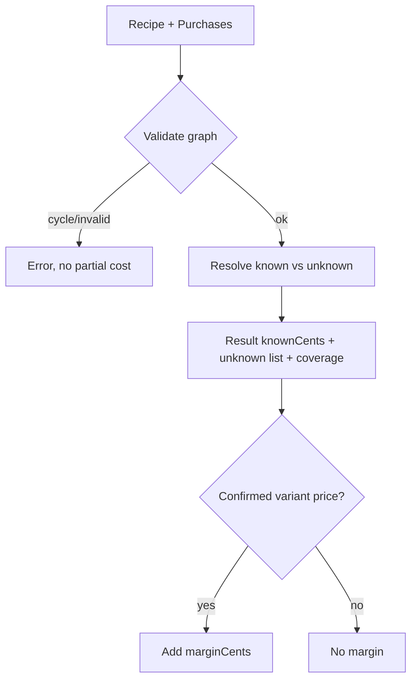
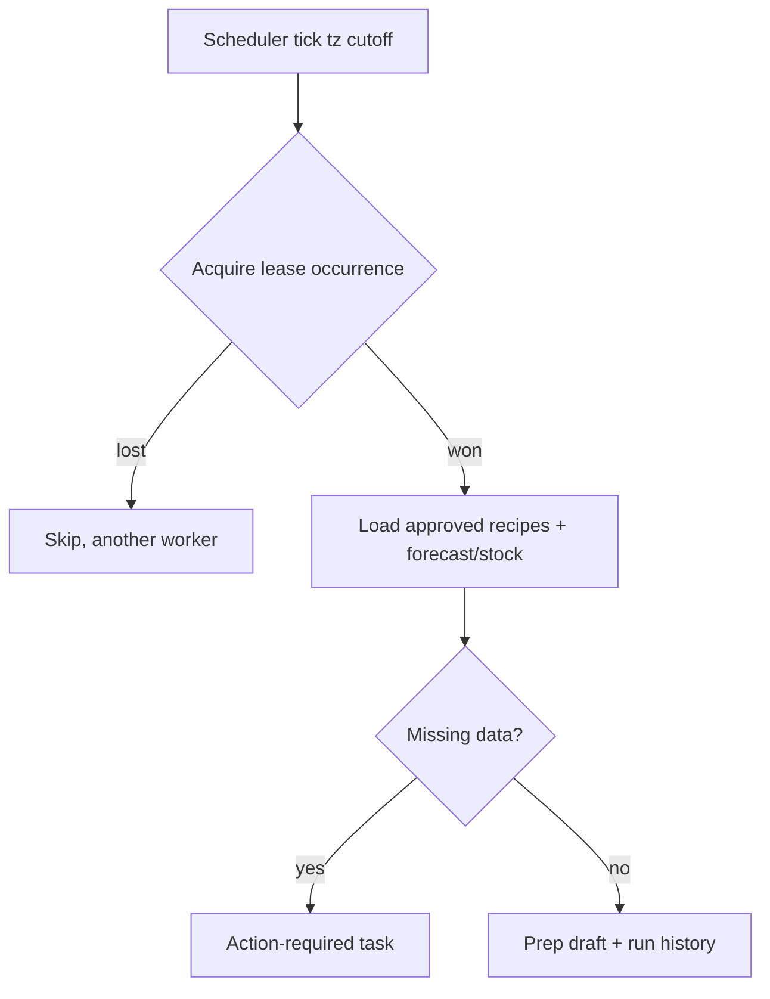
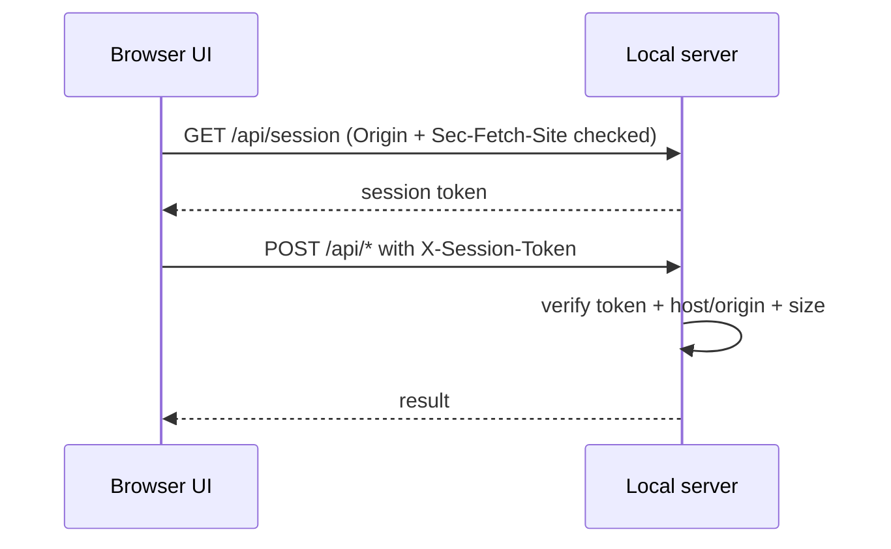

# Flows — Kitchen Tools

## F10 Import preview → commit
```mermaid
sequenceDiagram
  participant U as Operator
  participant API as Local API/MCP
  participant DB as SQLite
  U->>API: preview_import(payload, kind)
  API->>API: validate (F05) + diff vs current
  API->>DB: store preview (payload, expectedVersions, expires)
  API-->>U: preview token + missing/conflicts
  U->>API: commit_import(token, confirm:true)
  API->>DB: BEGIN; check versions; insert; COMMIT
  DB-->>API: ok / STALE_VERSION
  API-->>U: committed versions or 409
```

## F06 Costing


## F12 Daily prep job


## F14 Local session

